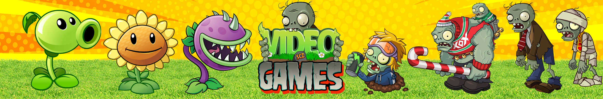

  

<h1 align="center">VIDEOGAMES SCZ</h1>

  <b>Creador de contenido de PS3, retro gaming, homebrew y modding</b> 
  +294K suscriptores en YouTube

  <a href="https://videogamesscz.com/mediakit/"><b>Ver el mediakit</b></a>
  &nbsp;·&nbsp;
  <a href="https://www.youtube.com/@VIDEOGAMESSCZ">YouTube</a>
  &nbsp;·&nbsp;
  <a href="https://www.instagram.com/videogames_scz">Instagram</a>
  &nbsp;·&nbsp;
  <a href="https://www.tiktok.com/@videogamesscz">TikTok</a>
  &nbsp;·&nbsp;
  <a href="https://x.com/SczVideogames">X</a>

---

Aquí encontrarás mis herramientas y proyectos para consolas (PS3, PS4, Xbox 360 y PC) en los repositorios de esta cuenta.

Colaboraciones y marcas: consulta el [mediakit](https://videogamesscz.com/mediakit/) o escribe a videogamesscz1@gmail.com.

Servicio técnico: [videogamesscz.com/videotec](https://videogamesscz.com/videotec/)
